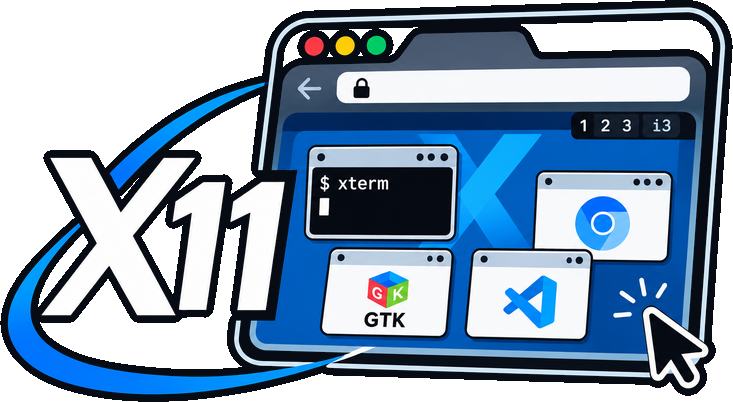
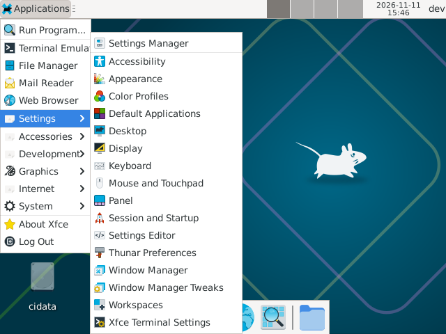
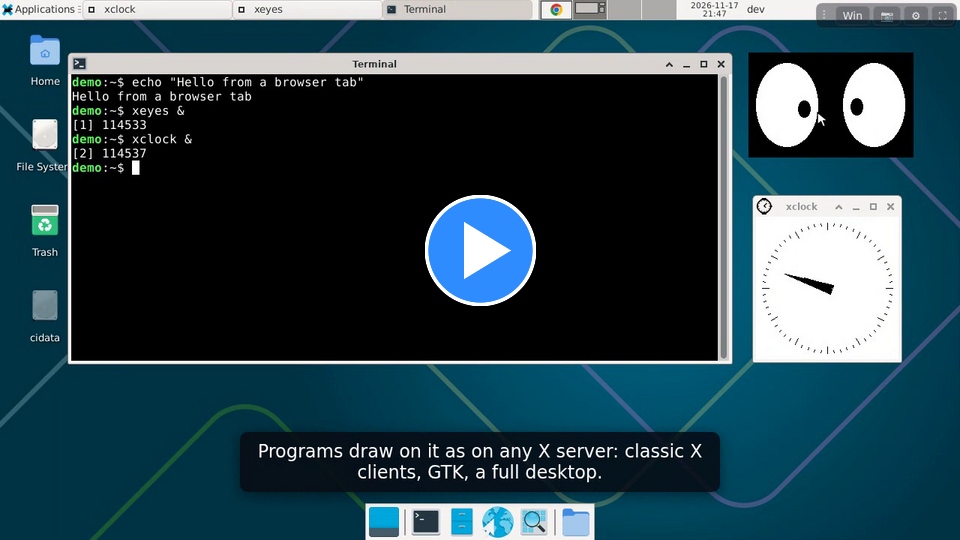

<p align="center">
  
</p>

# xsrv-web

**An X11 server written in Rust with an HTML5 canvas backend. Run Linux GUI applications directly inside any browser tab.**

## What it is

xsrv-web is an X11 server whose screen is a web page. A normal X server draws on a monitor;
xsrv-web draws in a canvas of a browser. Linux programs that use X (xterm, GTK 3 programs, Chromium
and Electron programs such as VS Code, window managers such as i3 or a whole XFCE desktop) connect
to it as to any X server, and you use them from a tab on any computer that has a browser.

It is one small program (17 MB of memory in the comparison, with a few programs open). It has no
VNC server, no virtual frame buffer and no browser plug-in: the X server itself speaks to the page.



A demo of 75 seconds, on YouTube (the file is also here: [docs/xsrv-web-demo.mp4](docs/xsrv-web-demo.mp4)):

[](https://youtu.be/7kO271UjClI)

## What it does

- **Shows programs in the browser.** Windows, menus, text, images and cursors appear in the tab.
  The page sends back the keyboard, the mouse, the wheel and touch input.
- **Shares the clipboard** in both directions: text, HTML and images.
- **Works over a slow link.** Only the pixels that changed are sent; a scroll or a window move is
  a small copy message, not new pixels.
- **Has a small control panel in the page:** keyboard layout, a Win / Cmd key, buttons for keys that
  the browser keeps for itself, macros, a screenshot button, full screen.
- **Serves several screens** from one process, one for each user.
- **Is simple to run:** a Debian package with a systemd service, a tarball, or a Docker image.

## How it works

```
X programs --(X11 protocol, Unix socket)--> xsrv-web --(WebSocket)--> the page in your browser
                                              ^                              |
                                              +-----(keys, mouse, clipboard)-+
```

1. A program draws with normal X requests. xsrv-web keeps the pixels of every window, the way an
   X server does, and builds the screen from them.
2. When a burst of drawing ends (a few milliseconds), the server compares the new screen with the
   old one and sends only the changed parts, as small compressed tiles. Where a region only
   moves (a scroll, a window drag), it sends a copy message instead.
3. The page decodes the messages with a WebAssembly module and draws them on a canvas. The same
   WebSocket carries back what you type, click and copy.

Everything runs in one thread and one process. [docs/architecture.md](docs/architecture.md) has
the details; [docs/security.md](docs/security.md) says who can reach what.

## Get started

On a Debian 13 or Ubuntu 24.04 machine (x86_64), with the package from `make deb` or a release:

```
sudo apt install ./xsrv-web_0.1.5_amd64.deb
sudo systemctl enable --now xsrv-web
sudo xsrv-web token
```

The last command prints the page address, for example
`http://127.0.0.1:8080/?token=hpzAEewFD44D7_HG4Badaiz4PCsdlmoR`. Open it in a browser and click the
page to give it the keyboard. Then start programs on the screen:

```
DISPLAY=:1 xterm &
```

**From another computer**, open `http://<server>:8080/?token=<token>` (the page listens on every
interface when it has a token). Outside a trusted network, set `XSRV_ADDR=127.0.0.1:8080` and open
an SSH tunnel instead, then use the same address on your computer:

```
ssh -L 8080:127.0.0.1:8080 user@server
```

**With a desktop**: set `XSRV_WM=0` in `/etc/default/xsrv-web`, restart the service
(`sudo systemctl restart xsrv-web`), and start a window manager on the screen, for example
`DISPLAY=:1 i3 &` ([docs/external-wm.md](docs/external-wm.md)). Without it, a small built-in
window manager gives each window a title bar and fills the screen with it.

The install guide, with the settings to check first, remote access, updates and removal:
[docs/install.md](docs/install.md).

## Add it to your own Docker image

xsrv-web is one program and a folder of page files, so it fits in any image that has glibc 2.39 or
newer (Debian 13, Ubuntu 24.04). An older base such as Debian 12 is too old. This Dockerfile takes
both from the release tarball and adds them to your image:

```dockerfile
FROM debian:trixie-slim AS xsrv
ARG XSRV_VERSION=0.1.5
RUN apt-get update && apt-get install -y --no-install-recommends ca-certificates curl \
 && rm -rf /var/lib/apt/lists/* \
 && curl -fsSL "https://github.com/csegura/xsrv_web/releases/download/v${XSRV_VERSION}/xsrv-web-${XSRV_VERSION}-linux-x86_64.tar.gz" \
  | tar xz --strip-components=1 -C /opt

# Your own image goes here, with your programs.
FROM debian:trixie-slim
RUN apt-get update && apt-get install -y --no-install-recommends xterm \
 && rm -rf /var/lib/apt/lists/* \
 && useradd --create-home --uid 10001 app
COPY --from=xsrv /opt/bin/xsrv-web /usr/local/bin/xsrv-web
COPY --from=xsrv /opt/share/xsrv-web/web /usr/local/share/xsrv-web/web
# entrypoint.sh is docker/entrypoint.sh of this repository, next to your Dockerfile.
COPY entrypoint.sh /usr/local/bin/entrypoint.sh
ENV DISPLAY=:1 \
    XSRV_ADDR=0.0.0.0:8080 \
    XSRV_X11_SOCKET=/tmp/.X11-unix/X1 \
    XSRV_WEB_DIR=/usr/local/share/xsrv-web/web
EXPOSE 8080
USER app
ENTRYPOINT ["/usr/local/bin/entrypoint.sh"]
CMD ["xterm"]
```

Build it, then run it with a token (the server refuses a network address without one) and open the
page:

```
docker build -t my-xsrv .
docker run --rm -e XSRV_TOKEN="$(openssl rand -hex 16)" -p 127.0.0.1:8080:8080 my-xsrv
```

Open `http://127.0.0.1:8080/?token=<the token you set>`; the xterm of the image appears on the page.

- **The entrypoint** starts xsrv-web, waits until its X socket exists, runs the command that you
  give (`CMD`) as an X client, and stops the server when that program ends. With no command it
  only runs the server.
- **Programs in other containers:** keep the server image as it is, put the socket folder on a
  shared volume (`-v x11:/tmp/.X11-unix`) and start the client with `DISPLAY=:1`. The files in
  `docker/` (`Dockerfile`, `Dockerfile.client`, `compose.yaml`) are a complete example with two
  containers ([docs/docker.md](docs/docker.md)).
- **Hardening:** the program needs no root and no capabilities. Run it with `--read-only`,
  `--cap-drop ALL`, `--security-opt no-new-privileges` and a tmpfs or volume for `/tmp`, as
  `compose.yaml` does. Keep the port on `127.0.0.1` and put a reverse proxy with TLS in front for
  remote use ([docs/security.md](docs/security.md)).
- **Settings:** every `XSRV_*` variable can go in `ENV` or `-e` ([packaging/README.txt](packaging/README.txt)).

This exact Dockerfile has not been built yet; see [docs/docker.md](docs/docker.md) for what was
tested.

## Using the page

- **Keyboard**: click the page first. The buttons sit in a bar in a corner (top right at first):
  Win, the gear and full screen. The gear opens the settings: the keyboard layout (us, es, gb,
  de) for the whole session, the wheel speed, which key of your keyboard acts as Win / Cmd (for
  example Right Ctrl, when your system keeps the Windows key), buttons for keys that the browser
  keeps for itself (Ctrl+W, Ctrl+T, Alt+Tab, Alt+F4, Ctrl+Alt+Del), and the corner of the bar.
  Click Win, then a key, for Win plus that key. The settings are kept in this browser.
- **Full screen**: the ⛶ button. In Chromium and Edge it also locks Escape, Tab, Alt and the
  Windows key, so that they reach the screen; hold Escape to leave.
- **Screenshot**: the camera button in the bar saves a PNG file of the screen; Shift+click copies the
  image to the clipboard instead. The Buttons tab of the settings can hide the button.
- **Clipboard**: text, HTML and images go both ways (up to 4 MB of text and 16 MB of image). Use
  Ctrl+V or Shift+Insert to paste; Ctrl+Shift+V pastes plain text. Content that cannot be pasted is
  told on the message line. Selecting text can copy it too (a setting). For copies from X programs to always reach your
  clipboard, click *Allow clipboard access* in Settings > Clipboard once. See `docs/clipboard.md`.
- **Touch**: one finger is the left button, two fingers scroll.

Details: [docs/input.md](docs/input.md), [docs/clipboard.md](docs/clipboard.md).

## Other ways to run it

- **Tarball** (any folder, any user, no root): `make dist`, unpack, `./start.sh`, open
  `http://127.0.0.1:8080/`.
- **Docker**: `make docker-build`, or `docker/compose.yaml` with an xterm container
  ([docs/docker.md](docs/docker.md)).
- **From the source** (needs `rustup`, the `wasm32-unknown-unknown` target and
  `wasm-bindgen-cli`): `make run`.

## Settings

All settings are environment variables; for the service they are in `/etc/default/xsrv-web`
(root only; after a change, `sudo systemctl restart xsrv-web`). The ones you are most likely to
need:

| Setting | Default | Meaning |
|---|---|---|
| `XSRV_PORT` | `8080` | The port of the page. |
| `XSRV_ADDR` | `0.0.0.0:$XSRV_PORT` with a token, `127.0.0.1:$XSRV_PORT` without | The full address of the page. It wins over `XSRV_PORT`. A network address needs a token. |
| `XSRV_TOKEN` | made at install | The page token. `sudo xsrv-web token` prints it. |
| `XSRV_X11_SOCKET` | `/tmp/.X11-unix/X1` | The X socket; `X1` is `DISPLAY=:1`. |
| `XSRV_X11_COOKIE` | none | 32 hex digits: X programs must show this cookie (`xauth add`). |
| `XSRV_KEYMAP` | `us` | The keyboard layout at start: `us`, `es`, `gb` or `de`. |
| `XSRV_WM` | `1` | `0` turns off the built-in window manager (for i3 and others). |
| `XSRV_COMPRESSION` | `lz4` | `zstd` sends fewer bytes on a slow network. |

The full list: [packaging/README.txt](packaging/README.txt). Security notes:
[docs/security.md](docs/security.md).

## When something does not work

- **The page says 401**: open it once with `?token=...` (`sudo xsrv-web token` prints the
  address); after that a cookie is enough.
- **The service does not start**: `journalctl -u xsrv-web`. On a desktop, `:1` may belong to a
  login screen: set `XSRV_X11_SOCKET=/tmp/.X11-unix/X10` and use `DISPLAY=:10`.
- **A program says "Can't open display"**: give it `DISPLAY=:1` (or the number you chose). With
  `XSRV_X11_COOKIE` set, it also needs `xauth add :1 MIT-MAGIC-COOKIE-1 <cookie>`.
- **Keys do nothing**: click the page first. The browser keeps some keys (Ctrl+W, the Windows
  key); use the buttons in the settings panel, or full screen in Chromium.
- **The wrong characters**: choose your layout in the settings panel; the page sends the physical
  keys, and the server decides what they type.
- **An update asks about `/etc/default/xsrv-web`**: keep your version (the default answer).

## What it can and cannot do

- X11 core protocol with backing store, and the extensions RENDER 0.1 (cairo, Xft and GTK use
  it), XKEYBOARD (read-only), SHAPE, MIT-SHM, XFIXES, RANDR (also virtual monitors),
  BIG-REQUESTS and XC-MISC ([docs/extensions.md](docs/extensions.md)).
- Only changed pixels are sent, as palette tiles where the colours are few, compressed with LZ4
  or zstd; scrolls and window moves are copy messages. Optional H.264 video with ffmpeg.
- Several screens in one process (`XSRV_SESSIONS`, [docs/sessions.md](docs/sessions.md)).
- No GLX (no 3D), no XInputExtension, no XTEST, and RENDER without trapezoids, transforms or
  gradients (programs draw those themselves). Qt programs are not tested.

## Documentation

| Document | What it covers |
|---|---|
| [docs/install.md](docs/install.md) | The three ways to install, what to check first, remote access, updates, removal. |
| [docs/external-wm.md](docs/external-wm.md) | Using i3 or another window manager instead of the built-in one. |
| [docs/input.md](docs/input.md) | Keyboard layouts, the Win / Cmd key, mouse, wheel and touch. |
| [docs/clipboard.md](docs/clipboard.md) | Copy and paste, formats, limits, the browser permission. |
| [docs/sessions.md](docs/sessions.md) | Several screens from one process. |
| [docs/docker.md](docs/docker.md) | The Docker image and `docker/compose.yaml`. |
| [docs/security.md](docs/security.md) | The token, the X cookie, limits and the known gaps. |
| [docs/extensions.md](docs/extensions.md) | The X11 extensions that are offered, and the ones left out on purpose. |
| [docs/architecture.md](docs/architecture.md) | How the server, the page and the messages between them fit together. |
| [packaging/README.txt](packaging/README.txt) | Every setting (`XSRV_*`) and the files of the packages. |
| `THIRD-PARTY-NOTICES.txt` | The licenses of the Rust crates that the program uses. |

## Development

| Command | What it does |
|---|---|
| `make check` | `cargo fmt --check`, `cargo clippy -D warnings`, `cargo test` |
| `make test-web` | the page scripts, with node and a fake canvas |
| `make bench` | bytes and time of screen updates for typical workloads |
| `make bench-web` | sizes of tiles, and the time that the page module needs to apply them |
| `make bench-latency` | time from an X11 request to the message at a page |
| `make web` | the WASM module of the page, into `web/pkg` |
| `make dist`, `make deb` | the tarball and the Debian package, into `dist/` |

How the parts fit together: [docs/architecture.md](docs/architecture.md). The licenses of the
Rust crates that the program uses: `THIRD-PARTY-NOTICES.txt`.

## License

xsrv-web is free software under the [GNU Affero General Public License version 3](LICENSE) (AGPL-3.0-only). If you run a changed version as a network service, you must offer its source code to the users of that service.
